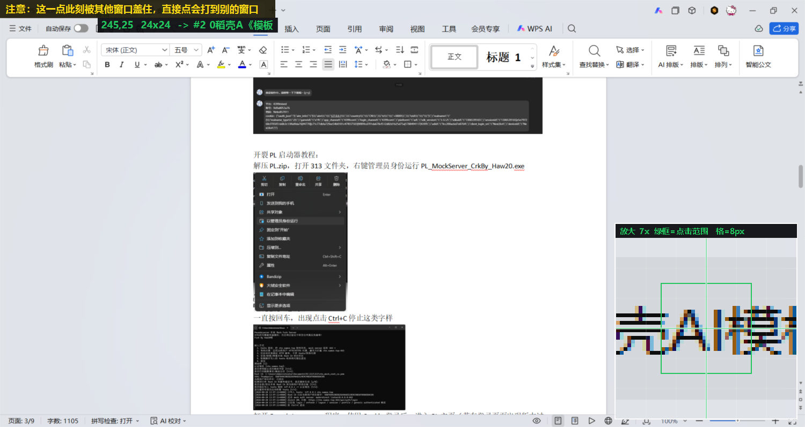

# Lens 电脑控制 / Lens Computer Control

零第三方依赖的桌面控制插件（DeepSeek Harness 插件）。Windows 用随包分发的原生 `lens.exe`（C#，用系统自带 `csc.exe` 编译），只调用系统自带的 Win32 / GDI+ / UIAutomation / WinRT OCR；**macOS 为实验性支持**，用随包的 `engine-mac.mjs` 调 `osascript`(JXA) / `screencapture` —— 不装 Python、不装 OpenCV、不拉任何 npm 依赖。

**设计铁律：模型永远不输出绝对坐标。** 引擎把窗口扫成一张「候选表」并给每个目标编号，模型只说「点 #17」，坐标由引擎从候选框算出来 —— 把定位从回归问题降级成分类问题，误差归零。

> **平台支持**：Windows 全功能；macOS 实验性（scan / check / click / type / key / paste / vision 切块可用，scroll / drag / 遮挡检测尚未实现，无 HUD 浮层，见文末「macOS 实验性支持」）。

## 三个关键能力

### 1. 坐标检验（`computer_check`）

模型把自己算的坐标交给它，回一张图：**该坐标被画成绿色框**（默认 24×24 鼠标热区）+ 十字准星 + 命中候选标注，右下角贴同一处的**放大镜**（最近邻放大 + 8px 像素格）。同时回报：

- `inside` —— 点是不是落在目标窗口内
- `covered` / `coveredBy` —— 此刻是否被别的窗口盖住、被谁盖住
- `pixel` —— 该点像素色
- `candidate` —— 命中了上次 `computer_scan` 的哪条候选（含文字）

只读：不移动鼠标、不发按键、不改窗口状态。


### 2. 坐标点击先预览、不落点（`confirmClicks`，默认开）

`computer_act {x, y}` **不再直接点**：先跑坐标检验，回上面那张绿框图 + 一个一次性确认令牌 `ck_xxx`；确认位置无误后再 `computer_act {confirm: "ck_xxx"}` 才真正点击。

- 点的是**令牌里记住的坐标**，不是这次传进来的（防止「看的是 A、点的是 B」）
- 令牌一次性、180 秒有效，复用/过期都拒绝
- `id` / `cell` 点击不预览（坐标本来就是引擎算的）；要跳过用 `force: true`
- **脚本也绕不过去**：`computer_run` 里带裸坐标的 `click x= y=` 会被拦下（`SCRIPT_COORD_CLICK_BLOCKED`）——脚本是「一次编排、中途没法确认」的形态，正好是预览要防的那类误点；改用 `click find=text:…` / `click id=…`（坐标由引擎算），或显式传 `force: true`
- **HUD 上也能裁决**：预览时 HUD 浮出一张待确认卡片（绿框图 + `确认点击` / `取消`），人不经过模型也能放行或丢掉这一次点击；模型确认与人工确认走同一套一次性令牌（`/pending`、`/preview`、`/confirm`、`/cancel` 见 [docs/USAGE.md](docs/USAGE.md)）



### 3. 设置面板（设置 → Lens 电脑控制）

HUD 开关、人类化输入节奏、坐标点击预览、兜底自动检验、引擎超时、坐标检验默认命中范围与放大倍率、**永不操作的窗口黑名单**（命中即 `WINDOW_BLOCKED`）。改完立刻生效，不用重启。

## 六个感知通道

| 通道 | 覆盖场景 |
|---|---|
| `uia` | 常规 Win32 / WPF / Electron 应用（白送像素级精度） |
| `ocr` | Windows 自带 OCR，原图 / 反色 / 2× 最近邻上采样三路 |
| `solid` | 量化颜色连通域，专抓实心 / 圆角按钮 |
| `table` | 行列投影，认行情软件的表格网格 |
| `textgrid` | 靠文字位置聚类行列，兜住暗色低对比、只画内线的自绘表 |
| `template` | 零均值 NCC 锚点，教一次永久精确 |

微信 / QQ / 飞书 / 券商行情 / Java Swing 这类 UIA 几乎为空的自绘窗口，靠后五个通道兜住。

## 安装

```bash
npm i dsh-lens-computer-control
```

或在 DSH 的插件市场里搜索「Lens 电脑控制」。

## 仓库结构

仓库根目录**就是 npm 包本体**（`dsh plugin add` 直接装这个仓库即可）：

```
package.json       dsh.bundle + dsh.client 清单；cordis.patch.yml 在根
index.js           工具层（computer_* 八个工具）
client.js          HUD 浮层 + 设置面板
engine-mac.mjs     macOS 引擎（Node，实验性；零依赖）
bin/lens.exe       Windows 引擎二进制（随包分发，直接可用）
bin/lenshud.exe    HUD 浮层进程
native/            引擎源码快照（与 src/ 同步，方便在包里对照）
src/               引擎 C# 源码（Program.cs 入口，Check.cs 坐标检验，Det/ 六个感知通道）
tools/             build-lens.ps1（系统 csc 重建引擎）等开发脚本
publish-tools/     npm staged publish + 浏览器 2FA 审批脚本
docs/              截图与详细用法（docs/USAGE.md）
```

完整用法（工具表、六通道细节、流程脚本、HUD、命令行）见 [docs/USAGE.md](docs/USAGE.md)。

## 自己构建

```powershell
powershell -NoProfile -File tools/build-lens.ps1
```

只需要系统自带的 `csc.exe`（.NET Framework 4.x）+ Windows SDK 的 `Windows.winmd`（WinRT OCR 用）。产物是 `bin/lens.exe` 与 `bin/lenshud.exe`。

## macOS 实验性支持

macOS 上没有 Win32/UIA，`lens.exe` 跑不了，于是另带一个**零依赖的 Node 引擎** `engine-mac.mjs`，`index.js` 按 `process.platform` 自动切换：

| 能力 | Windows | macOS（实验性） |
|---|---|---|
| 窗口列表 `computer_windows` | Win32 枚举 | JXA / System Events |
| 候选扫描 `computer_scan` | 六通道（uia/ocr/实心/表格/文字网格/模板） | AX 通道 + **OCR 通道**（AX 为空时自动补文字行） |
| 坐标检验 `computer_check` | GDI+ 绘制 | Node 内解 PNG + 画框 + 最近邻放大（自己实现编解码） |
| 切块定位 `computer_vision` | 引擎绘制分格图 | 同样支持，`cells` 模式带编号与坐标 |
| 点击 / 输入 / 按键 / 粘贴 | SendInput / PostMessage / 剪贴板 | System Events `click at`、`keystroke`、`pbcopy + cmd+v`（粘完写回原剪贴板） |
| 滚动 / 拖动 | ✔ | ✔ `CGEventCreateScrollWheelEvent` / 按下-移动-抬起 |
| 像素差分核验 `verify` | ✔ | ✔ 与上一张快照比，额外给 `hoverSuspected`（只变一小块时提示"可能是悬停"） |
| 遮挡检测 | WindowFromPoint | ✔ `CGWindowListCopyWindowInfo` 按层级顺序判最上层窗口 |
| 脚本编排 `computer_run` | ✔ 引擎内解释 | ✔ 引擎内解释（window/focus/click/type/key/paste/scroll/drag/wait/sleep） |
| HUD 浮层（蓝边+胶囊） | `lenshud.exe` | 无（Web 面板状态卡照常） |

启用步骤：

1. 装好插件后，首次调用会触发系统授权弹窗；
2. 到「系统设置 → 隐私与安全性」里给**宿主进程**（DSH Desktop / 终端）勾上 **辅助功能** 与 **屏幕录制**；
3. 重启宿主，`computer_windows` 能列出窗口即接通。

```bash
# 也可以单独试引擎（不需要插件）
node engine-mac.mjs info --json
node engine-mac.mjs scan --window Safari --overlay /tmp/scan.png
node engine-mac.mjs vision --mode cells --cells 9 --out /tmp/cells.png
```

已知限制：AX 树在 Electron / Qt / 游戏里通常为空，这类窗口只能靠 `computer_vision` 切块 + `computer_check` 预览。OCR 走三级回退：① 已编译的 `bin/ocr-mac`（或缓存）→ ② 若系统有 `swiftc`，首次调用时自动编译随包的 `native/mac/ocr-mac.swift`（Vision 框架，约 120 行）→ ③ 借名为 `LensOCR` 的快捷指令（`shortcuts run`）。三者都没有时 `computer_look mode:"text"` 返回 `OCR_UNAVAILABLE`，`scan` 会降级成只有 AX 候选。

```bash
# 手动预编译（可选，省掉首次调用的编译延迟）
swiftc -O native/mac/ocr-mac.swift -o bin/ocr-mac
```

## 已知限制

- 反截屏窗口（`WDA_EXCLUDEFROMCAPTURE`）下截图全黑，只能做引导不能代点
- AWT/Swing 窗口不响应后台 `PostMessage` 点击，必须前台真点击
- macOS 支持为实验性，能力矩阵见上一节

## 许可

MIT
